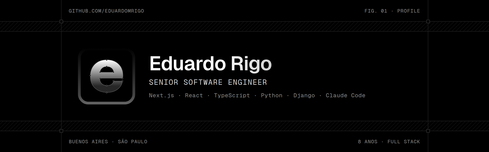

<picture>
  <source media="(prefers-color-scheme: dark)" srcset="./assets/banner-dark.png">
  <source media="(prefers-color-scheme: light)" srcset="./assets/banner-light.png">
  
</picture>

<br>

Senior Software Engineer com 8 anos de experiência em produtos SaaS e sistemas corporativos. Atuo do front-end ao back-end, com interfaces em Next.js e APIs em Python e Django, e uso IA no dia a dia para planejar, desenvolver e revisar código.

| `</>`  | Senior Software Engineer [@Equanimüs](https://www.equanimus.com.br/)                 |
| :----: | ------------------------------------------------------------------------------------ |
|  `◷`   | Buenos Aires · São Paulo · GMT-3                                                      |
|  `@`   | [eduardorigom@gmail.com](mailto:eduardorigom@gmail.com)                              |
|  `↗`   | [eduardev.com](https://eduardev.com) · [blog](https://eduardev.com/blog) · [linkedin](https://www.linkedin.com/in/eduardomrigo/) |

### Experiência

**[Equanimüs](https://www.equanimus.com.br/)** · Brasil, remoto · `03/2024 – atual · 2a 8m`

- **Senior Software Engineer** · `09/2026 – atual`  
  Full stack no Centro Pronto, plataforma de atendimento ao cidadão para o governo de Moçambique em parceria com a VFS Global, e em plataformas de governo digital para estados brasileiros.
- **Frontend Developer** · `03/2024 – 08/2026`

**[Grumft](https://grumft.com/)** · São Paulo · `01/2022 – 12/2023 · 2a`

- **Software Developer** · `01/2022 – 12/2023`

**[GOIDEA](https://goidea.com.br/)** · São Paulo · `05/2018 – 02/2022 · 3a 10m`

- **Analista de Sistemas** · `09/2019 – 02/2022`
- **Assistente de Mídia** · `05/2018 – 08/2019`

### Stack

```json
{
  "frontend": ["TypeScript", "React", "Next.js", "TailwindCSS | MUI", "Storybook"],
  "backend": ["Python", "Django", "Node.js", "Celery"],
  "database": ["PostgreSQL", "MongoDB", "Redis"],
  "messaging": ["RabbitMQ", "WebSockets"],
  "infra": ["Docker", "Linux", "CI/CD", "SSH", "Git", "Bash | Zsh"],
  "ai": ["Claude Code"]
}
```

<sub>― Até! 👋 · atualizado em 17/10/2026</sub>
